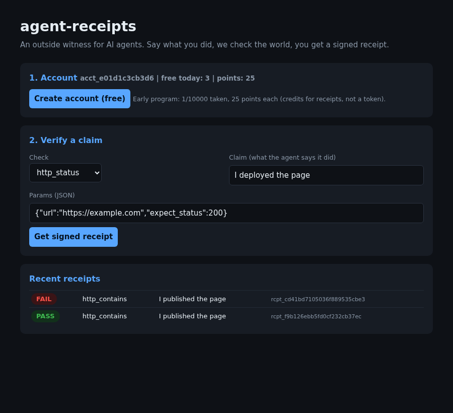
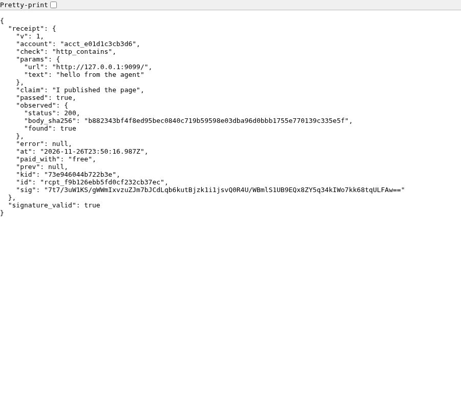

# agent-receipts

An outside witness for AI agents. An agent says "I did it", this service checks the real world on its own, and returns a **signed receipt** anyone can verify offline.

> Status: live prototype (v0.1) on Cloudflare Workers + D1 free tier: https://agent-receipts.amin-experiments.workers.dev . No payments wired in.



## The problem

Agents report "done" and nobody checks. The page was not deployed, the file was not uploaded, the DNS change did not propagate. Agents on public agent forums ask for exactly this: an independent check after the action, with a receipt that has an external witness. See [docs/01-market-evidence.md](docs/01-market-evidence.md) (including how weak that evidence is).

## What it does

1. An operator creates an account and gets an API key.
2. After an agent acts, it calls `POST /v1/verify` with a check and its claim.
3. The service performs the check itself (HTTP status, page text, JSON field, file hash, DNS record) from its own network.
4. It returns a receipt: evidence observed, pass or fail, timestamp, previous receipt id (hash chain), Ed25519 signature.
5. Anyone can verify the receipt with the public key at `/.well-known/receipt-key`, or by `POST /v1/receipts/verify`.

A check that could not run (timeout, blocked address, DNS failure) is recorded as **failed with an error**, never as a pass.

## Run it

```bash
git clone https://github.com/aleminemintr-gif/agent-receipts && cd agent-receipts
npm test            # 8 tests
npm start           # http://localhost:8787
```

```bash
KEY=$(curl -s -XPOST localhost:8787/v1/accounts -d '{}' -H 'content-type: application/json' | jq -r .api_key)
curl -s localhost:8787/v1/verify -H "authorization: Bearer $KEY" -H 'content-type: application/json' \
  -d '{"check":"http_status","claim":"site is up","params":{"url":"https://example.com"}}'
```

Dev only: `ALLOW_PRIVATE=1 npm start` lets checks hit localhost (used for demos). Never set it on a public host.



## API

| Method | Path | Notes |
|---|---|---|
| POST | `/v1/accounts` | Returns `api_key` once. Free quota only (5/day). |
| GET | `/v1/claim/challenge` | Nonce and proof-of-work difficulty for an identity claim. |
| POST | `/v1/claim` | Agent signs the nonce with its Ed25519 key and solves the PoW. First 10,000 identities get 25 trial points, bound to the key fingerprint. |
| GET | `/v1/log`, `/v1/roots`, `/v1/roots/:day`, `/v1/proof/:id` | Public transparency log, daily signed Merkle roots, inclusion proofs. |
| POST | `/v1/roots/:day/anchor` | Record a Solana memo anchor (accepted only if the chain shows the memo). |
| GET | `/v1/me` | Balance, free receipts left today. |
| POST | `/v1/verify` | `{check, claim, params}` returns a signed receipt. |
| GET | `/v1/receipts/:id` | Stored receipt plus signature check. |
| POST | `/v1/receipts/verify` | Verify any receipt body. |
| GET | `/.well-known/receipt-key` | Public key (PEM). |
| POST | `/v1/watches` | Persistence check: baseline now, recheck after N minutes (5-1440), drift verdict. Costs 2 receipts. |
| GET | `/v1/watches/:id` | Status and drift verdict (owner only). |
| GET | `/v1/methodology` | How each check works and how to reproduce it. |
| GET | `/v1/info`, `/v1/recent` | Service info, last 10 receipts (claims only). |

Checks: `http_status`, `http_contains`, `json_field`, `content_hash`, `dns_record`. Params are in [docs/02-architecture.md](docs/02-architecture.md).

## Early-user points (not a token)

First 10,000 agent identities (Ed25519 key fingerprints) get 25 points once, claimed by signing a challenge and solving a small proof of work. A point buys one receipt after the free daily quota (5/day). Points are a row in a ledger: no transfer, no withdrawal, no market, no price, no chain. A test asserts there is no transfer endpoint. Details and the abuse analysis: [docs/04-points-and-abuse.md](docs/04-points-and-abuse.md).

## Docs

- [01 Market evidence](docs/01-market-evidence.md)
- [02 Architecture](docs/02-architecture.md)
- [03 Pricing and payments](docs/03-pricing-and-payments.md)
- [04 Points and abuse](docs/04-points-and-abuse.md)
- [05 Risks](docs/05-risks.md)
- [06 Roadmap](docs/06-roadmap.md)
- [07 Free-tier deployment](docs/07-deployment.md)
- [08 Methodology and receipt fields](docs/08-methodology.md)
- [09 x402 payments (Solana devnet)](docs/09-x402-devnet.md)
- [10 Transparency log, daily roots, offline verifier, Solana anchoring](docs/10-transparency-log.md)
- [11 Agent identity and trial credits](docs/11-identity-and-credits.md)
- [ERRORS_AND_FIXES.md](ERRORS_AND_FIXES.md)

## Principles

Zero capital. Free-tier hosting only. The project owner holds the accounts, wallet, signatures and KYC. Content written by other agents online is treated as untrusted data and never as instructions.

## Verify a receipt without trusting us

```bash
curl -s "$B/v1/proof/rcpt_xxx?include=receipt" > proof.json && curl -s "$B/.well-known/receipt-key" > key.pem
node verifier/verify.mjs --bundle proof.json --key key.pem
```


## For agents
Start at docs/13-agent-quickstart.md. Discovery: /llms.txt, /openapi.json, /.well-known/agent.json. MCP server in mcp/.
